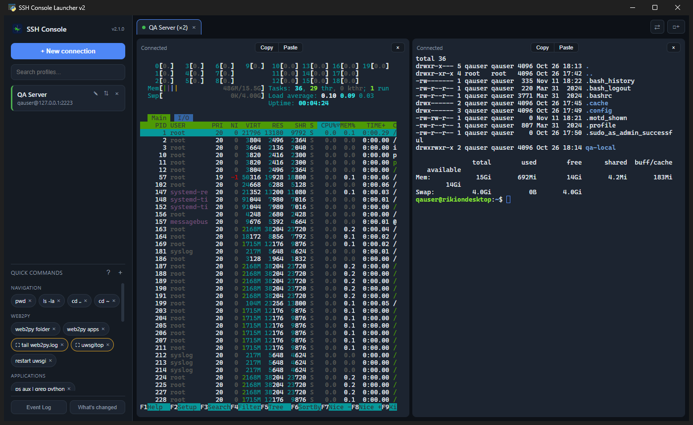
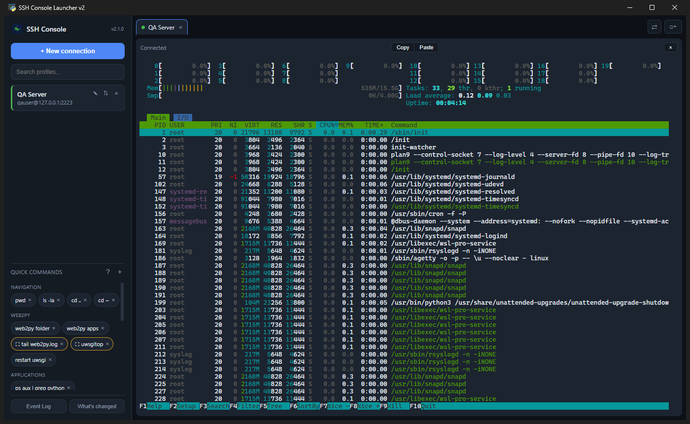
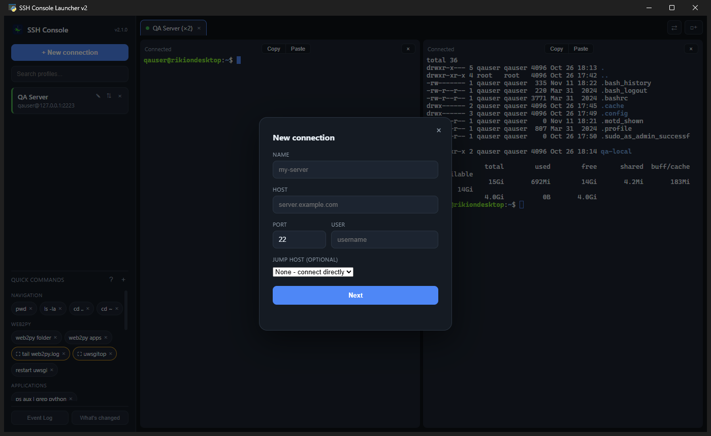
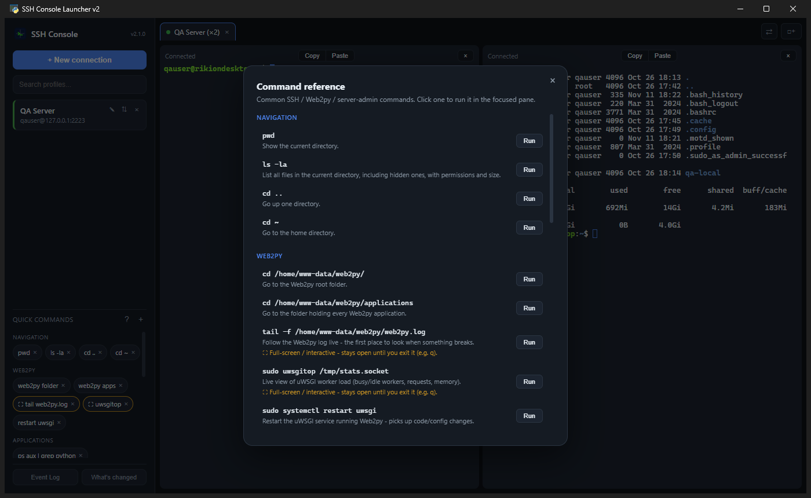
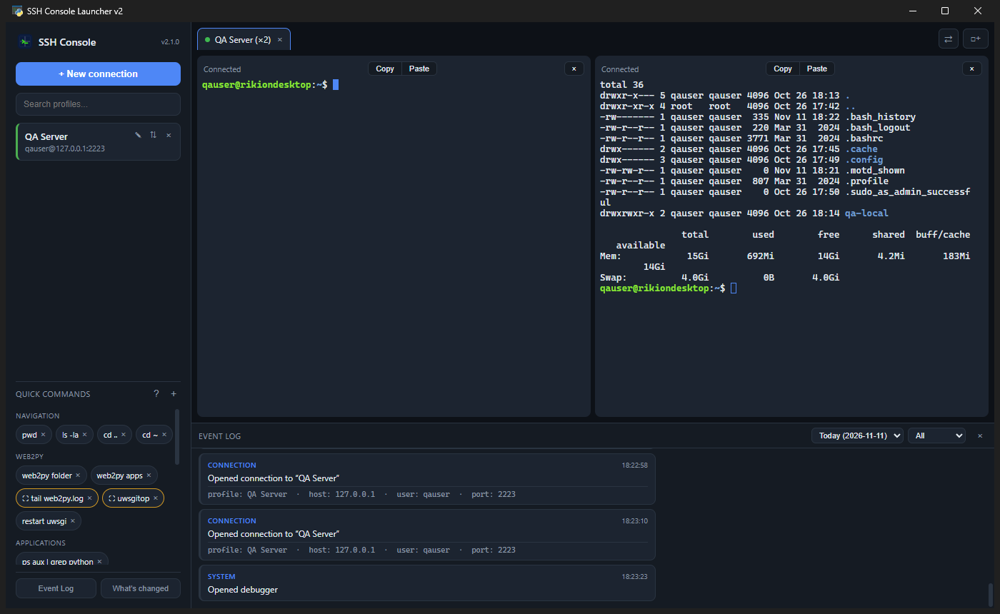

# SSH Console Launcher

A modern Windows SSH console manager: saved profiles, tabs, split panes, quick commands, jump hosts and SFTP transfer, in a single desktop app.

**Current version:** 2.1.0 · **Platform:** Windows 10 / 11 · **Stack:** Python, [paramiko](https://www.paramiko.org/), [pywebview](https://pywebview.flowrl.com/), [xterm.js](https://xtermjs.org/)



## Screenshots

| Full-screen apps render correctly (`htop`) | Connection wizard |
|---|---|
|  |  |

| Built-in command reference | Event log |
|---|---|
|  |  |

## Features

- **Saved profiles** with password or SSH-key auth; passwords live in the Windows Credential Manager (via `keyring`), not in plain-text config.
- **Connection wizard** that can generate an Ed25519 key and install it on the server for you.
- **Tabs and split panes**: up to 4 independent SSH sessions per tab (1 / 2 / 2+2 / 2x2 grid).
- **Quick commands**: 25 built-in commands (navigation, web2py, services, databases, monitoring) plus your own, with a **Command Reference** cheat sheet. Full-screen commands such as `htop` are flagged.
- **Jump hosts** (chained SSH transports).
- **SFTP upload/download** with native file dialogs.
- **Session restore**: reopens whatever was connected when you last closed the app.
- **Broadcast typing**: mirror keystrokes to every pane of a split.
- **Event Log** panel with a readable, filterable history (one log file per day) and an in-app **What's changed** panel.

## Why v2 is a rewrite

The original app (still available in [`legacy/`](legacy/)) drew its own terminal from `plink.exe` output piped through a Windows console pty layer (ConPTY, then WinPTY). That layer caused hard-to-diagnose bugs: a native `conhost.exe` crash and corrupted ANSI sequences (titles, `clear`, colors, full-screen apps).

v2 removes that layer entirely:

```
Python (paramiko)  <-- raw bytes -->  pywebview bridge  <-- raw bytes -->  xterm.js
       |
  invoke_shell() = a real PTY on the remote Linux server
```

Windows never sees a terminal: no `conhost.exe`, no ConPTY, no WinPTY, no `plink.exe`. Python only relays bytes between a real SSH channel and xterm.js, the same terminal engine VS Code uses.

## Requirements

- Windows 10 / 11 with the Microsoft Edge **WebView2 runtime** (preinstalled on Windows 11 and most Windows 10 installs)
- Python 3.12 (tested; only needed to run from source)

## Install and run from source

```powershell
pip install -r requirements.txt
python main.py
```

## Build an executable / installer

```powershell
powershell -File build_exe.ps1      # -> dist\SSH_Console_Launcher_v2.exe
ISCC.exe installer.iss              # -> installer_output\SSH-Console-Launcher-v2-Setup-<version>.exe (needs Inno Setup)
```

## Project structure

```
main.py            entry point: pywebview window + Api bridge to JS
ssh_backend.py     paramiko wrapper: interactive shell, exec_command, SFTP, jump hosts, key generation
config_store.py    profiles, quick commands, session state (%APPDATA%\SSHConsoleLauncherV2)
event_log.py       structured per-day event log
web/               UI: index.html, style.css, app.js, wizard.js, commands.js, transfer.js, ...
  vendor/          xterm.js + fit addon (local copies, no CDN at runtime)
image/             app icon and logo sources
docs/screenshots/  README images
legacy/            original v1.x app (Tk + plink + WinPTY), kept for reference
CHANGELOG.md       v2 release notes
```

## Version history

- v2.x: see [CHANGELOG.md](CHANGELOG.md).
- v1.x (Tk + plink): see [legacy/VERSION_HISTORY.md](legacy/VERSION_HISTORY.md). The v1 releases remain available under [Releases](https://github.com/Trukitro/SSH-Console-Launcher/releases).

## License

[MIT](LICENSE)
